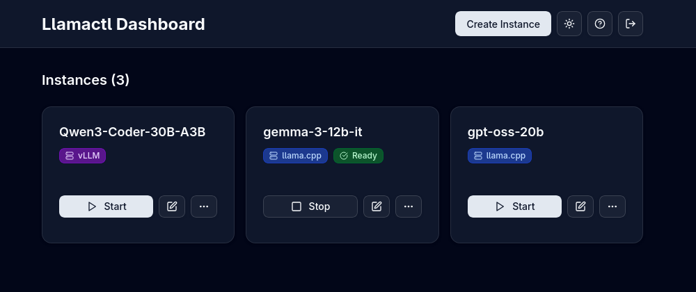

# llamadeck

   

**Unified management and routing for llama.cpp, MLX and vLLM models with web dashboard.**

📚 **[Full Documentation →](https://llamadeck.org)**



## Features

**🚀 Easy Model Management**
- **Built-in Model Downloader**: Download GGUF and Safetensors models directly from HuggingFace for llama.cpp, vLLM, and MLX backends
- **Dynamic Multi-Model Instances**: llama.cpp router mode - serve multiple models from a single instance with on-demand loading
- **Smart Resource Management**: Automatic idle timeout, LRU eviction, instance groups with per-group limits, and configurable instance limits
- **Web Dashboard**: Modern React UI for managing instances, monitoring health, and viewing logs

**🔗 Flexible Integration**
- **API Compatible**: OpenAI chat completions and resources endpoints, Anthropic messages endpoint (depending on backend) - route requests to different models by instance name
- **Multi-Backend Support**: Native support for llama.cpp, MLX (Apple Silicon optimized), and vLLM, plus any OpenAI-compatible server via configurable custom backends
- **Docker Ready**: Run backends in containers with full GPU support

**🌐 Distributed Deployment**
- **Remote Instances**: Deploy instances on remote hosts
- **Central Management**: Manage everything from a single dashboard with automatic routing  

## Quick Start

1. Install a backend (llama.cpp, MLX, or vLLM) - see [Prerequisites](#prerequisites) below
2. [Download llamadeck](#installation) for your platform
3. Run `llamadeck` and open http://localhost:8080
4. Create an instance and start inferencing!

## Prerequisites

### Backend Dependencies

**For llama.cpp backend:**
You need `llama-server` from [llama.cpp](https://github.com/ggml-org/llama.cpp) installed:

```bash
# Homebrew (macOS)
brew install llama.cpp

# Or build from source - see llama.cpp docs
# Or use Docker - no local installation required
```

**For MLX backend (macOS only):**
You need MLX-LM installed:

```bash
# Install via pip (requires Python 3.8+)
pip install mlx-lm

# Or in a virtual environment (recommended)
python -m venv mlx-env
source mlx-env/bin/activate
pip install mlx-lm
```

**For vLLM backend:**
You need vLLM installed:

```bash
# Install via pip (requires Python 3.8+, GPU required)
pip install vllm

# Or in a virtual environment (recommended)
python -m venv vllm-env
source vllm-env/bin/activate
