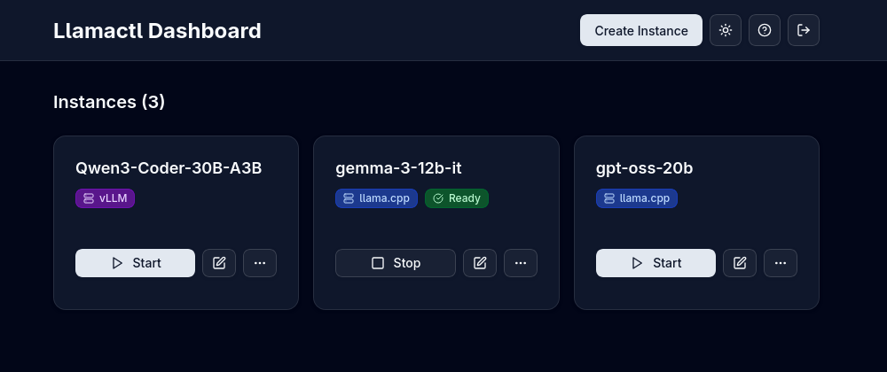
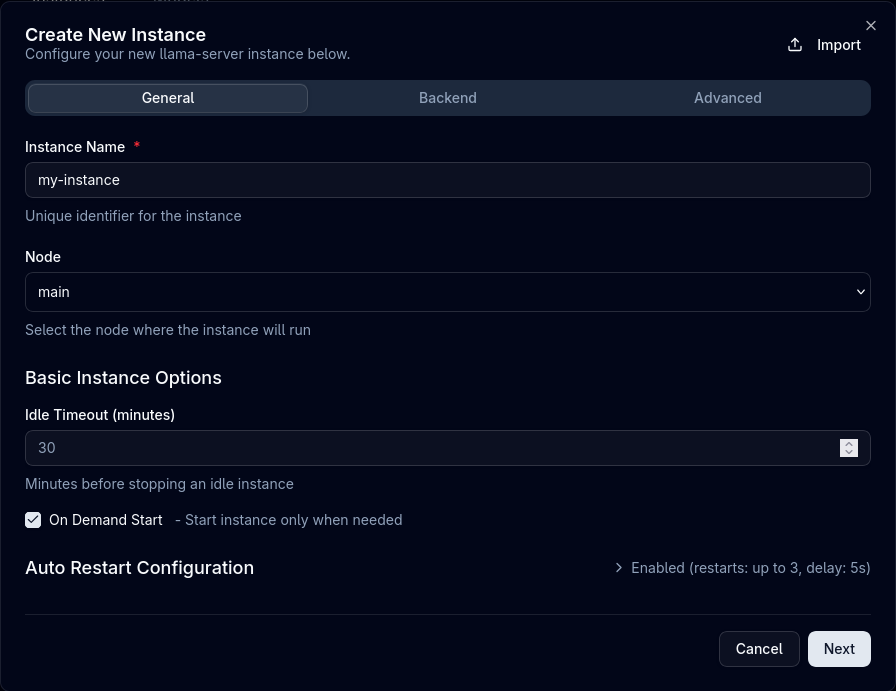

# Managing Instances

Learn how to effectively manage your llama.cpp, MLX, and vLLM instances with Llamadeck through both the Web UI and API.

## Overview

Llamadeck provides two ways to manage instances:

- **Web UI**: Accessible at `http://localhost:8080` with an intuitive dashboard
- **REST API**: Programmatic access for automation and integration

### Authentication

Llamadeck uses a **Management API Key** to authenticate requests to the management API (creating, starting, stopping instances). All curl examples below use `<token>` as a placeholder - replace this with your actual Management API Key.

By default, authentication is required. If you don't configure a management API key in your configuration file, llamadeck will auto-generate one and print it to the terminal on startup. See the [Configuration](configuration.md) guide for details.

For Web UI access:
1. Navigate to the web UI
2. Enter your Management API Key
3. Bearer token is stored for the session

### Theme Support

- Switch between light and dark themes
- Setting is remembered across sessions

## Instance Cards

Each instance is displayed as a card showing:

- **Instance name**
- **Health status badge** (unknown, ready, error, failed)
- **Action buttons** (start, stop, edit, logs, delete)

## Create Instance

**Via Web UI**

The create instance dialog uses a tabbed interface to organize settings. Navigate between tabs using **"Next"** and **"Back"** buttons.

1. Click the **"Create Instance"** button on the dashboard
2. *Optional*: Click **"Import"** to load a previously exported configuration

### General Tab

Configure basic instance settings:

3. Enter a unique **Instance Name** (required)
4. **Select Node**: Choose which node to deploy the instance to
5. Configure **Auto Restart** settings:
    - Enable automatic restart on failure
    - Set max restarts and delay between attempts
6. Configure basic instance options:
    - **Idle Timeout**: Minutes before stopping idle instance
    - **On Demand Start**: Start instance only when needed

### Backend Tab

Configure backend and execution options:

7. **Select Backend Type**:
    - **Llama Server**: For GGUF models using llama-server
    - **MLX LM**: For MLX-optimized models (macOS only)
    - **vLLM**: For distributed serving and high-throughput inference
8. *Optional*: Click **"Parse Command"** to import settings from an existing backend command
9. **Execution Context** (click to expand):
    - **Enable Docker**: Run backend in Docker container
    - **Command Override**: Custom path to backend executable
    - **Environment Variables**: Custom environment variables
10. Configure **Basic Backend Options** (varies by backend):
    - **llama.cpp**: Model path, threads, context size, GPU layers, etc.
    - **MLX**: Model identifier, temperature, max tokens, etc.
    - **vLLM**: Model identifier, tensor parallel size, GPU memory utilization, etc.

!!! tip "Auto-Assignment"
    Llamadeck automatically assigns ports from the configured port range (default: 8000-9000) and generates API keys if authentication is enabled. You typically don't need to manually specify these values.

### Advanced Tab

Configure advanced backend options:

11. Expand **Advanced Backend Options** for additional backend-specific settings
12. Add **Extra Args** as key-value pairs for custom command-line arguments
13. Click **"Create Instance"** to save the instance  

### Custom Backends

Custom backend instances reference a `backends.custom.<name>` entry from the [configuration](configuration.md#custom-backends); each configured name appears in the backend dropdown. Their options:

- `name` (required): the config entry to use.
